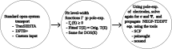

Zandpack: Timedependent Nanoelectronics Simulation with Nonequilibrium Green's Functions
========================================================================================

Hello there, you have entered the Zandpack documentation! Zandpack is a code
developed for modeling time-dependent nanoelectronics. It grew out of the
following Ph.D. project:

* `Quantum transport theory of nanostructures: transient response and ... <https://orbit.dtu.dk/en/publications/quantum-transport-theory-of-nanostructures-transient-response-and>`_

and is released together with the publication:

* `https://doi.org/10.1016/j.cpc.2026.110087 <https://doi.org/10.1016/j.cpc.2026.110087>`_

.. grid:: 1 1 3 3
   :gutter: 2

   .. grid-item::

      .. button-ref:: quickstart/readme
         :ref-type: doc
         :color: primary
         :expand:

         Introduction

   .. grid-item::

      .. button-ref:: examples/index
         :ref-type: doc
         :color: primary
         :expand:

         Examples

   .. grid-item::

      .. button-ref:: api
         :ref-type: doc
         :color: primary
         :expand:

         API reference

.. grid:: 2
   :gutter: 3

   .. grid-item-card:: :fas:`person-running` Quick-start guides
      :link: quickstart/nbtutorial
      :link-type: doc

      Jump to the introductory tutorials.

   .. grid-item-card:: :fas:`book-open` Introduction
      :link: quickstart/readme
      :link-type: doc

      Read the introduction, installation guide and features.

.. grid:: 2
   :gutter: 3

   .. grid-item-card:: :fas:`flask` Examples
      :link: examples/index
      :link-type: doc

      Runnable example calculations shipped with Zandpack.

   .. grid-item-card:: :fas:`code` API reference
      :link: api
      :link-type: doc

      Command-line tools and the Zandpack Python API.

.. grid:: 1
   :gutter: 3

   .. grid-item-card:: :fas:`envelope` Contact
      :link: mailto:aleksander.bl@proton.me

      E-mail: aleksander.bl@proton.me

.. toctree::
   :maxdepth: 2
   :caption: Getting started

   Introduction <quickstart/readme>

.. toctree::
   :maxdepth: 2
   :caption: Examples

   examples/index

.. toctree::
   :maxdepth: 2
   :caption: Command-line tools

   cmdtoolsdoc/index

.. toctree::
   :maxdepth: 2
   :caption: API reference

   api
